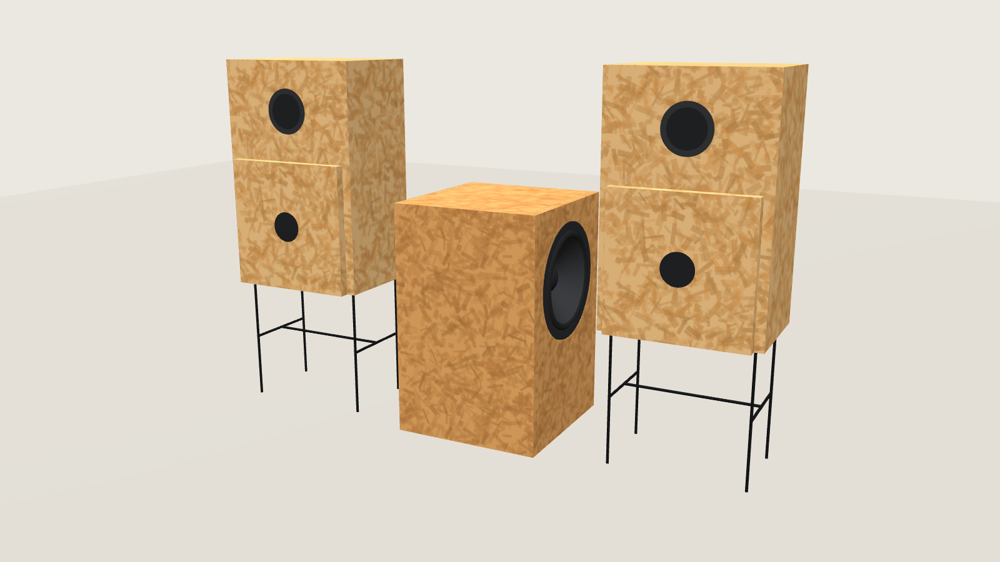
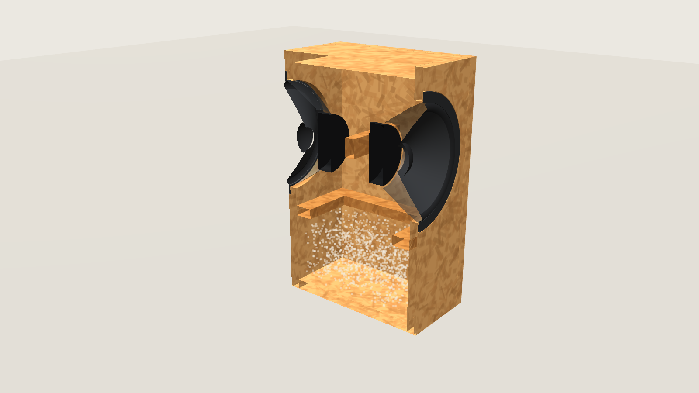
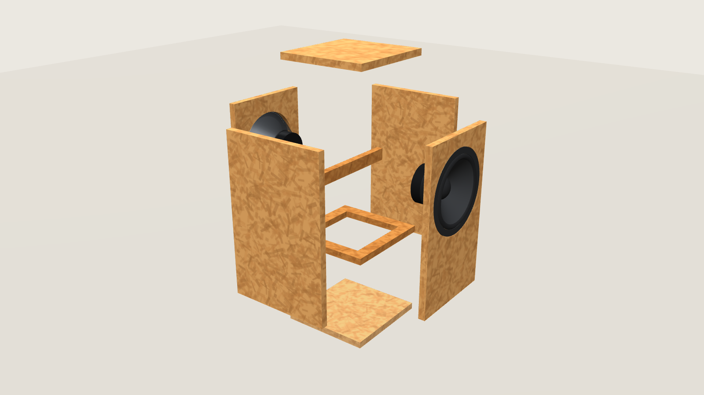

# Le Petit Sub on a budget

**Le Petit's bigger twin: a sealed subwoofer with two opposed 10″ drivers, built from one sheet of
OSB with exactly Le Petit's 340 × 530 front.**

📖 Also readable as a website, with the interactive 3D model: **https://rich1704.github.io/le-petit-sub-on-a-budget/**

The companion to [Le Petit on a budget](https://github.com/rich1704/le-petit-on-a-budget).

[](https://rich1704.github.io/le-petit-sub-on-a-budget/3d-model/)

> **In short**
>
> - **One 2000 × 1000 mm board** of 22 mm OSB, two cross cuts, and a 924 × 990 piece stays whole.
> - **Le Petit's front, 340 × 530**, and its plain butt-jointed OSB: next to the pair it reads as one set.
> - **2 × SB Acoustics SB26SFCL38-4** (10″) in the side panels, back to back: the forces on the box
>   cancel, and the front stays a quiet face.
> - **Sealed, ≈ 40 l net**, braced, glued shut; the drivers sit flush and come out from outside.
> - **≈ €190 in parts** plus the OSB board. Every drawing is generated from one file of dimensions.

## Contents

[Why a sub](#why-a-sub) · [How it works](#how-it-works) · [3D model](#3d-model) · [Build it](#build-it) ·
[Parts and cost](#parts-and-cost) · [Repository map](#repository-map) · [Credits](#credits-and-license)

## Why a sub

- **Le Petit stays Le Petit.** Its strength is the midrange and the coherence of one full-range
  driver. None of that changes: the sub only takes over the bottom octaves, below about 80 Hz.
- **The 4″ drivers get cleaner.** Freed from the deep bass, the small cones stop fighting for
  excursion they don't have.
- **Real bass from a small box.** Two 10″ cones move about as much air as one 14″, in a box no bigger
  than Le Petit's front. Below 80 Hz you can't hear where bass comes from, so one sub between the
  pair is enough.
- **It looks like part of the set.** Same front size, same OSB, same plain edges. The drivers sit in
  the sides, so from the front it's a quiet block next to the pair.

## How it works


- **Forces cancel.** A moving cone pushes the box the other way. Two mirrored drivers with the same
  signal push in opposite directions, so the box doesn't rock, buzz through the floor or walk.
- **Sealed, no port.** No port noise, no tuning to get right, tight timing in the bass, and the air in
  the box holds the cones.
- **Braced where the panels would flex.** The forces cancel, the air pressure on the panels doesn't.
  A tie strip links front and back between the magnets — 38 mm clear of each — and a window brace
  just below the drivers ties all four walls.
- **Flush drivers.** The 3.56 mm frames sit in a 4.5 mm recess on gasket tape, so the sides stay as
  plain as Le Petit's front.

## 3D model

Turn it, look inside, cut it open, explode it, play the cones — **[open the 3D model](https://rich1704.github.io/le-petit-sub-on-a-budget/3d-model/)**.

| Cut open | Exploded |
| --- | --- |
| [](https://rich1704.github.io/le-petit-sub-on-a-budget/3d-model/) | [](https://rich1704.github.io/le-petit-sub-on-a-budget/3d-model/) |

## Build it

| | Specification |
| --- | --- |
| **Box** | 340 × 530 × 350 mm outside (W × H × D), 296 × 486 × 306 inside = **44.0 l gross, ≈ 40 l net** |
| **Material** | one 2000 × 1000 mm board of 22 mm OSB, square edges |
| **Construction** | front and back are full 340 × 530 plates over everything; sides between them, top and bottom between plates and sides — **biscuits (size 20) + wood glue, glued shut** |
| **Drivers** | 2 × SB Acoustics SB26SFCL38-4, 10″, 4 Ω, flush in a Ø267 × 4.5 recess, Ø231 cutout, 6 × M5 inserts each |
| **Bracing** | tie strip 306 × 40 on edge between the magnets; window brace of four 40 × 22 strips, 330 below the top |
| **Damping** | 300–500 g loose wool, lower half and corners |
| **Wiring** | 4-core cable through an M20 gland in the back, one pair per driver, both + to + |
| **Weight** | ≈ 18 kg: OSB ≈ 12.5 kg, drivers 2 × 2.9 kg |

**Everything from one board, two cross cuts:**


**The building plan** — three A3 sheets with every dimension, cut list, holes, biscuit positions and
assembly order: [docs/building-plan.md](docs/building-plan.md).

[](docs/building-plan.md)

**The build guide** in 13 steps — [docs/01-build.md](docs/01-build.md): cut, driver holes, seal,
biscuit slots, the open box, braces, corners, back plate, last corners, finish, cable and wool,
drivers, leak test.

**The driver and the box** — mounting dimensions from the datasheet, volume, bracing and damping:
[docs/02-driver-and-box.md](docs/02-driver-and-box.md).

> **Check before you cut.** The driver dimensions come from SB Acoustics' datasheet, marked
> *preliminary data*. Rout a test recess in scrap and drop a delivered driver in before you touch
> the side panels, and measure your OSB — if it isn't exactly 22 mm, the inside sizes change with it.

## Parts and cost

Driver price from soundimports.eu (NL, ships within the EU), small parts from the DIY store, October 2026.

| Part | Cost |
| --- | ---: |
| 2 × SB Acoustics SB26SFCL38-4, 10″, 4 Ω, €72.95 each | €146 |
| Shipping, approx. | €10 |
| 12 × M5 inserts + 12 × M5 × 16 screws | €10 |
| Gasket tape and wool fill | €15 |
| 4-core speaker cable + M20 cable gland | €8 |
| **Parts, approx.** | **≈ €190** |
| 22 mm OSB, one 2000 × 1000 board (0.92 m² used) | DIY store |

## Repository map

```
docs/
├── 3d/index.html            the interactive 3D model (three.js), with the Le Petit pair
├── 01-build.md              build guide, 13 steps, parts list, cutting plan
├── building-plan.md         the building plan: three A3 sheets, cut list, holes, joints
├── 02-driver-and-box.md     driver mounting data, volume, bracing, damping, why these choices
├── plans/                   building-plan sheets (SVG + PNG) and the cutting plan
└── assets/                  3D stills and the diagram
tools/
├── sub.py                   every dimension and driver value, plus the geometry checks
├── make_building_plan.py    the three A3 sheets
├── make_cut_layout.py       the cutting plan
├── make_diagrams.py         the diagram
├── shoot_3d.py              stills of the 3D model for this README
├── svg2png.py               PNG previews of the sheets (headless Chrome)
└── sync_index.py            the website's home page from this README
```

To regenerate everything after changing a dimension in `tools/sub.py`: `make` (needs Python 3 with
matplotlib, and Chrome for the previews and the 3D stills).

## Credits and license

The sub is designed to sit next to **Le Petit**, **Jean Hiraga's** design (*L'Audiophile* no. 29,
1983) — see [Le Petit on a budget](https://github.com/rich1704/le-petit-on-a-budget). Driver data:
SB Acoustics' SB26SFCL38-4 datasheet. Documentation, drawings and the 3D model: **CC BY-SA 4.0**;
the scripts in `tools/`: MIT. Details: [docs/CREDITS.md](docs/CREDITS.md).
