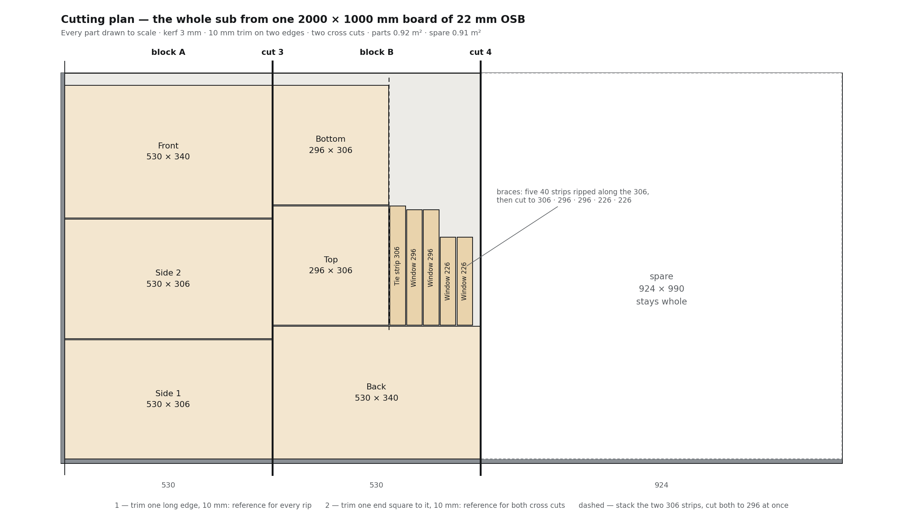
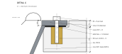
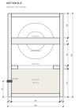

# Build guide

From one board of OSB to the first note, in the order you'll do it. The
[building plan](building-plan.md) has every dimension; this guide adds the order, the cutting plan
and the reasons.

> **Status: plan.** The sub isn't built yet. Photos and lessons from the build will be added to each
> step as it happens.

| | At a glance |
| --- | --- |
| **Result** | a sealed 44-litre box, 340 × 530 × 350 mm, two opposed 10″ drivers in the sides |
| **Material** | one 2000 × 1000 mm board of 22 mm OSB, square edges |
| **Tools** | track or circular saw, **router with a circle jig** (or a jigsaw for the cutout), **biscuit joiner**, drill, clamps and a ratchet strap, caulking gun, multimeter |

## Parts list

- [ ] 2 × SB Acoustics SB26SFCL38-4, 10″, 4 Ω
- [ ] 1 × OSB board, 22 mm, 2000 × 1000 mm, **square edges** (no tongue and groove)
- [ ] 48 biscuits, size 20
- [ ] 12 × M5 threaded inserts for wood (Ø6.5 drill) and 12 × M5 × 16 pan-head screws with washers
- [ ] foam gasket tape, 3 × 10 mm, ≈ 1.7 m (a ring under each driver frame)
- [ ] 1 × M20 cable gland and 4-core speaker cable, 2.5 mm², long enough to reach the amp
- [ ] 300–500 g loose wool fill (sheep's wool or polyester)
- [ ] wood glue (PVA), clear water-based lacquer, acrylic sealant

## 1 — Cut the board

Every part is drawn to scale; 3 mm kerf and 10 mm trim on two edges are included.

1. Trim one long edge, 10 mm — the reference for every rip.
2. Trim one end square to it, 10 mm — the reference for both cross cuts.
3. Two cuts straight across the board at **530** and **530**. The rest, 924 × 990, stays whole.
4. Cut the two blocks up:

| Block | Cuts | Parts |
| --- | --- | --- |
| A, 530 long | rip 306, 306, 340 | side 1, side 2 (530 × 306), front (530 × 340) |
| B, 530 long | rip 340, then 306, 306 | back (530 × 340), two 306 strips |
| B's 306 strips | stack them, cut both to **296** | top and bottom, 296 × 306 |
| offcut beside the top, 231 × 306 | rip five 40 strips along the 306 | tie strip 306 · window brace 296, 296, 226, 226 |

> **Tips** — Rip all four 306 parts at one fence setting and both 340 plates at another, so depth
> and faces match exactly. Measure your OSB first: if it isn't 22 mm, top and bottom become
> 340 − 2 × thickness wide and the brace lengths change with them. Label every part and mark its
> show face as it comes off.

Downloads: [SVG](plans/cut-layout-2000x1000.svg) · [PNG](plans/cut-layout-2000x1000.png) ·
[generator script](https://github.com/rich1704/le-petit-sub-on-a-budget/blob/main/tools/make_cut_layout.py)

## 2 — Driver holes and gland hole

The drivers sit **flush** in the side panels: the frame is 3.56 mm thick, so it goes into a 4.5 mm
recess on a ring of gasket tape. Both side panels are identical — centre **153 mm from either long
edge, 175 mm below the top**.

| Order | Hole | Size |
| --- | --- | --- |
| 1 | recess, outside face | Ø267 × 4.5 deep — router with a circle jig |
| 2 | 6 insert holes on a Ø250 circle, one at 3 and one at 9 o'clock, the rest at 60° steps | Ø6.5 × 13 deep, M5 inserts |
| 3 | cutout, through | Ø231 |
| — | cable gland, back plate, centred, 100 mm above the bottom edge | Ø20.5 for M20 |

Recess and inserts go in **before** the cutout, while the panel is still whole: the wall between an
insert and the cutout is only 5.5 mm.

> **Test first.** Rout the recess in an offcut and drop a delivered driver in. The datasheet gives
> the frame as Ø265 ± 0.5 and the basket behind it as Ø228.9; the recess and cutout leave about 1 mm
> per side. The datasheet is marked *preliminary*.

## 3 — Seal the inside faces

OSB is porous, and a sealed box must not leak. Two coats of thinned lacquer on every inside face
**before** assembly. Mask the 22 mm glue strips and keep lacquer out of the biscuit slots — glue
doesn't hold on lacquer.

## 4 — Biscuit slots

48 biscuits, size 20, slots centred in the 22 mm thickness:

| Joint | Biscuits |
| --- | --- |
| Front and back plates onto the sides, 530 edges | 6 per edge at 45 / 133 / 221 / 309 / 397 / 485 from the top |
| Front and back plates onto top and bottom | 3 per edge at 70 / 170 / 270 from the plate's edge (= 48 / 148 / 248 on the top/bottom) |
| Sides onto the ends of top and bottom | 3 per edge at 50 / 153 / 256 from the front |

> **Biscuits in OSB** — reference the joiner from the face (both parts face down on a flat surface),
> not from the fence: OSB varies in thickness. Check every slot for voids between the chips and move
> it 20 mm if it's hollow.

## 5 — The open box

Front plate face down on a flat surface. Glue sides, top and bottom onto it with their biscuits —
sides onto the plate, top and bottom between the sides — and strap-clamp. Dry-fit the back plate
(no glue) to hold everything square while it sets; check the diagonals.

## 6 — Braces

- **Window brace:** four strips laid flat, top face **330 mm below the top** of the box. Two 296
  strips against the front and back, two 226 strips between them against the sides. Glued to all
  four walls — spacer blocks set the height.
- **Tie strip:** 306 × 40 on edge, centred left to right, **155–195 mm below the top**, glued to the
  front plate now and to the back plate in step 8. It clears each magnet by about 38 mm.

Each brace sits where the panels would flex most: the tie strip in the middle of the front and back's
upper span, the window brace tying all four walls just below the drivers.

## 7 — Seal the corners

A bead of acrylic sealant in every inside corner you can still reach: along the front plate and
where sides meet top and bottom.

## 8 — Back plate

Glue on the back plate with its 18 biscuits and glue on the tie strip's end. Strap and cauls across
the plate, check the diagonals once more.

## 9 — The last corners

Through the driver holes, run the acrylic bead along the back plate's inside corners. A caulking gun
reaches comfortably — the holes are 231 mm across.

## 10 — Finish

Sand 80, then 120 only — the resin-rich chips are harder than the binder, finer grits make the
surface wavy. Two to three coats of clear water-based lacquer, as on Le Petit.

## 11 — Cable and wool

Fit the M20 gland, pull the 4-core cable through and tighten it. Seal round the gland's thread.
Then push 300–500 g of loose wool in through the driver holes: the lower half and the corners,
loosely, and keep a hand's width free around each driver basket.

No wall felt: the box's internal standing waves start around 350 Hz, far above the 80 Hz crossover.

## 12 — Drivers

1. Wire one pair to each driver, **both + to +**.
2. **Polarity check:** touch a 1.5 V battery to the cable ends at the amp side, + to +. Both cones
   must move **outwards** at the same time.
3. Gasket tape on the recess floor, driver in, M5 × 16 screws crosswise, snug — not tight.

## 13 — Leak test

Press one cone in gently with flat fingers and let go. In a sealed box it should come back **slowly**.
If it springs back at once, there's a leak: listen for it with a low tone at low level, or feel for
air at the joints, the gland and the driver frames.

Then on to the [amp and DSP](02-amp-and-dsp.md) — the subsonic filter and the limiter go in before
the first loud note.
