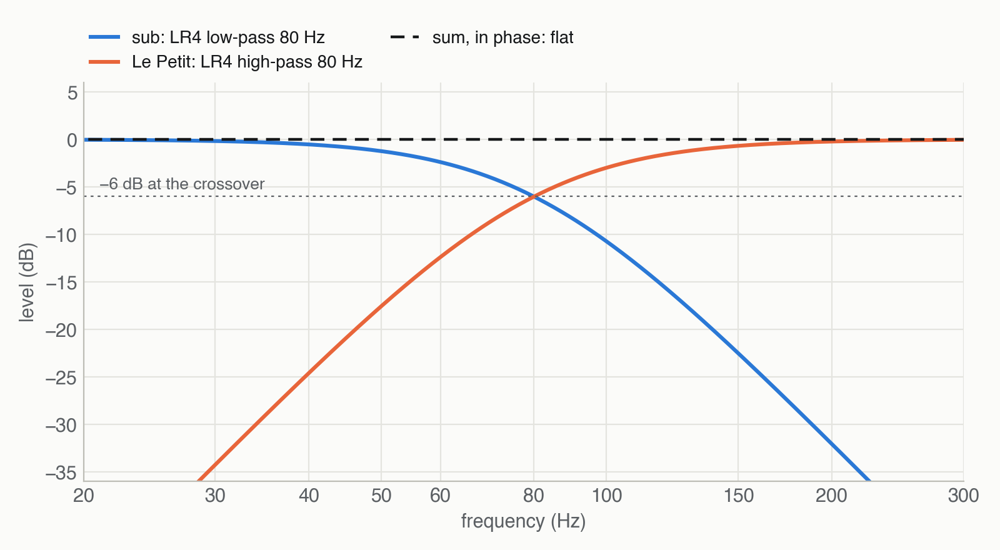

# Amp and DSP

The sub needs its DSP the way a vented box needs its port: the box alone is −3 dB at 52 Hz, and the
Linkwitz transform, the crossover, the subsonic filter and the limiter make it a 25 Hz subwoofer that
can't hurt itself.


## The amp

| | |
| --- | --- |
| **Board** | one stereo TPA3255 class-D board on 48 V, outside the sub — nothing is built into the box |
| **Supply** | 48 V, 5 A or more: both channels at the limiter draw about 180 W |
| **Channels** | left channel → left driver, right channel → right driver |
| **Input** | one mono sub output from the interface, split to both board inputs with a Y-cable — or OUT 3 and OUT 4 with the same signal |
| **Cable** | 4-core speaker cable, 2.5 mm², through the M20 gland: one pair per driver |
| **Polarity** | both drivers **+ to +**; the mirrored mounting makes the cones move out together |

**Why two channels and not one:** each driver gets a full channel, and both halves of the board carry
the same load and heat. The drivers are 4 Ω each — what the TPA3255 delivers best.

**Polarity check:** touch a 1.5 V battery to the cable ends, + to +. Both cones must move outwards
at the same time. If one moves in, the box shakes instead of standing still.

## The DSP chain

| Step | Setting | Why |
| --- | --- | --- |
| Mono sum | L + R at −6.02 dB each | a centred sound keeps its level; bass is mono below 80 Hz anyway |
| Headroom | −14 dB | the next three filters together boost up to +13.2 dB at 21 Hz |
| Linkwitz transform | 67.7 Hz / Q 1.06 → 25 Hz / Q 0.707 | turns the sealed box's early, slightly peaky roll-off into a smooth one at 25 Hz |
| Low-pass | Linkwitz–Riley, 4th order, 80 Hz | the crossover to Le Petit |
| Subsonic | Butterworth high-pass, 2nd order, 18 Hz | keeps the transform's boost off content nobody hears |
| Level | set by measurement | sub and Le Petit equally loud round the crossover |
| Delay | set by measurement | sub and Le Petit in phase at 80 Hz |
| Limiter | 18 V at the amp output | 18² / 4 Ω ≈ 81 W, the driver's 80 W rating |
| **Le Petit** | Linkwitz–Riley high-pass, 4th order, 80 Hz | replaces its protective high-pass |


### The Linkwitz transform

A sealed box is a second-order high-pass. In this box it sits at **Fc 67.7 Hz with Q 1.06** — slightly
peaky, and −3 dB at 52 Hz. The Linkwitz transform is one biquad that cancels exactly that high-pass
and puts a new one in its place, here at **25 Hz with Q 0.707** (Butterworth: the flattest roll-off
without a peak). The price is boost: +17 dB at the very bottom. The subsonic filter takes the boost
away again below 20 Hz, so the peak of the whole chain is +13.2 dB at 21 Hz.


**Fc and Q come from the datasheet.** Once the sub is built, measure them: the impedance peak of the
driver in the box gives Fc directly, and the near-field response gives Q. Then set `freq_act` and
`q_act` to the measured values — that's what makes the transform exact.

### The crossover

Linkwitz–Riley, 4th order, at 80 Hz on both sides: each side is −6 dB at the crossover, and in phase
they add up flat. Below 80 Hz you can't tell where bass comes from, so one sub between the pair works.



### Subsonic filter and limiter: required, not optional

- **Subsonic, 18 Hz.** Without it, the transform's +17 dB goes to rumble, wind noise on recordings
  and the record player's warp — power and excursion spent on nothing you hear.
- **Limiter, 18 V.** The TPA3255 on 48 V can deliver more than the driver's 80 W rating. In a sealed
  box the air protects the cone: at 18 V it moves at most 5.4 mm, 68 % of Xmax. So the limiter
  protects the voice coils from heat, and the cones keep a margin ([excursion](03-design.md#excursion)).

## The CamillaDSP config

[docs/dsp/le-petit-sub.yml](dsp/le-petit-sub.yml) — a complete CamillaDSP v4 config with Le Petit on
outputs 0 and 1 and the sub on 2 (and a copy on 3). Keep your own `devices:` section; only the
playback device needs four channels.

```yaml
pipeline:
  - type: Mixer
    name: to_sub            # 2 in, 4 out: L, R, sub, sub copy
  - type: Filter
    channels: [0, 1]
    names: [lepetit_hp]
  - type: Filter
    channels: [2, 3]
    names: [sub_headroom, sub_lt, sub_lp, sub_subsonic, sub_level, sub_delay, sub_limiter]
```

**Checked against the real thing:** [tools/verify_camilla.py](https://github.com/rich1704/le-petit-sub-on-a-budget/blob/main/tools/verify_camilla.py)
renders an impulse through CamillaDSP 4.1.3 and compares both outputs with the filters the charts are
drawn from — within **0.03 dB** from 15 to 300 Hz.

## Setting it up

### 1 — The limiter

`clip_limit` is in dBFS at the limiter, so it depends on your interface and amp gain:

1. Start with the drivers connected and the amp volume low.
2. Temporarily take every sub filter except `sub_level` out of the pipeline and play a **60 Hz sine at
   −20 dBFS** on both inputs.
3. Read the AC volts at the sub's cable ends with a multimeter: that's **V₋₂₀**. At full scale the
   amp would give **V₀ = 10 × V₋₂₀**.
4. Set `clip_limit = 20 × log10(18 / V₀)`. Example: V₋₂₀ = 2.5 V → V₀ = 25 V → clip_limit = −2.9 dB.
   If V₀ is below 18 V, the amp can't exceed the rating: set 0.
5. Put the filters back.

### 2 — Level and delay

Measure at the listening seat — with [REW](https://www.roomeqwizard.com/) or any sweep tool:

1. **Level:** Le Petit alone, then the sub alone. Set `sub_level` so both are equally loud between
   60 and 100 Hz.
2. **Delay:** both together. Change `sub_delay` in 0.5 ms steps until the response round 80 Hz is
   at its loudest and smoothest. Cross-check by inverting the sub (`inverted: true` on `sub_level`):
   the right delay now gives the deepest dip at 80 Hz.
3. Then let the room have its say: the sub's position on the floor changes the bass more than any
   filter. Near a wall or a corner adds level for free; keep a hand's width free on both sides,
   the drivers fire sideways.

### 3 — Fc and Q

After the build, measure the box's real Fc and Q (impedance peak, near-field response) and enter them
in `sub_lt`. Wool, the exact volume and the driver's spread move them a little.
