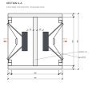

# Driver and box

What the box is built around, and why it's built the way it is. Every dimension lives in
[tools/sub.py](https://github.com/rich1704/le-petit-sub-on-a-budget/blob/main/tools/sub.py), which
also checks them; the drawings are generated from it.

## The driver

**SB Acoustics SB26SFCL38-4** — 10″, 4 Ω, hard-pressed vented paper cone, rubber surround, bucking
magnet, 80 W. From SB Acoustics' datasheet *"10″ SB26SFCL38-4, Preliminary data, Rev. 1 (16.09.2022)"*:

| Mounting | mm | | In the box | |
| --- | --- | --- | --- | --- |
| Frame outside | Ø265 ± 0.5 | | Recess | **Ø267 × 4.5** — frame + 1 mm per side |
| Frame thickness | 3.56 | | Gasket under the frame | ≈ 1 compressed, so the frame sits flush |
| Basket behind the frame | Ø228.9 | | Cutout | **Ø231** — basket + 1 mm per side |
| Bolt circle | Ø250 ± 0.2, 6 × Ø5.3 | | Fixing | 6 × M5 inserts, Ø6.5 × 13 deep, M5 × 16 screws |
| Depth behind the frame | 116.8 (128.1 overall) | | Magnet to tie strip | **≈ 38** |
| Magnet | Ø120 | | Weight | 2.9 kg each |

The holes sit at 3 and 9 o'clock and in 60° steps between, as on the datasheet. Between each insert
and the cutout there is 5.5 mm of OSB, so the recess and the inserts go in before the cutout.

> The datasheet is marked *preliminary*. Rout a test recess in scrap and drop a delivered driver in
> before you cut the side panels.

## The box

| | |
| --- | --- |
| Outside | 340 × 530 × 350 mm — Le Petit's front, 96 mm deeper |
| Inside clear | 296 × 486 × 306 mm = **44.0 l** |
| Braces | tie strip 0.27 l + window brace 0.92 l = 1.2 l |
| Drivers | ≈ 1.5 l each (basket and magnet) |
| **Net** | **≈ 40 l** — each driver works into half of it |
| Weight | ≈ 18 kg: OSB ≈ 12.5 kg, drivers 2 × 2.9 kg |

**Front and back are full plates** over everything, like Le Petit's front, so from either end you see
one clean face. Sides sit between them, top and bottom between plates and sides. That gives only three
panel sizes from the board — 530 × 340, 530 × 306 and 306 × 296 — and two cross cuts.

## Bracing

The two drivers cancel each other's push on the box, but not the air pressure on the panels: every
bass note pushes the big panels out and pulls them back in. An unbraced panel flexes like a drum skin
and sounds along — a dull drone in the bass. A brace ties two opposite walls in the middle of their
free span, where they'd bend most, and turns each panel into smaller, stiffer fields.

- **Tie strip** — 306 × 40 on edge, centred left to right, 155–195 mm below the top: it ties front and
  back in the middle of their upper span, between the magnets, 38 mm clear of each.
- **Window brace** — four 40 × 22 strips laid flat, 330 mm below the top: it ties all four walls just
  below the drivers and links the two driver panels directly.

Both together take 1.2 l of the box and come out of the offcut beside the top panel.

## Damping and sealing

- **Loose wool, 300–500 g**, in the lower half and the corners, pushed in through the driver holes
  once the box is glued. Keep a hand's width free around each basket.
- **No wall felt.** The box's internal standing waves start where half a wavelength fits the longest
  inside dimension: 343 / (2 × 0.486 m) ≈ 353 Hz, then 560 and 579 Hz — far above where the sub plays.
- **Airtight.** A sealed box must not leak: two coats of thinned lacquer inside before assembly, an
  acrylic bead in every inside corner, the gland sealed, gasket tape under each frame. The leak test
  is the last step of the [build guide](01-build.md#13-leak-test).

## Why these choices

| Choice | Instead of | Because |
| --- | --- | --- |
| Two drivers, opposed | one driver | twice the cone area, and the forces on the box cancel |
| 10″ | 8″ | far more air moved in a box that still has Le Petit's front |
| Sealed | vented | no port to fit, tune or hear; the smallest box for the bass |
| Drivers in the sides | in the front | the front stays a plain face next to the pair |
| Flush in a 4.5 mm recess | surface-mounted | a clean side; the frame is only 3.56 thick |
| Full front and back plates | inset back | one clean face from either end, three panel sizes, two cross cuts |
| Glued shut | removable back | a sealed box must not leak, and the drivers come out from outside anyway |
