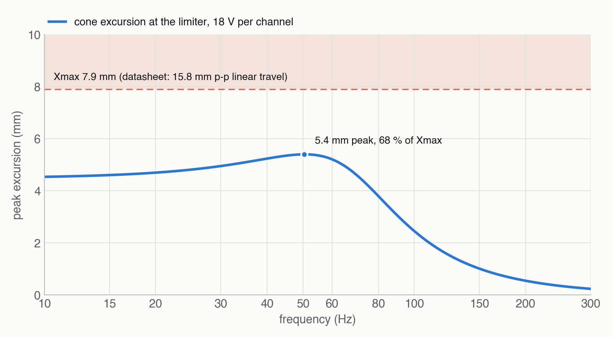

# Design and predictions

Where every number on the other pages comes from: the driver's datasheet, the box, and a
Thiele/Small model of the two together. All of it is computed by
[tools/make_charts.py](https://github.com/rich1704/le-petit-sub-on-a-budget/blob/main/tools/make_charts.py)
from the values in [tools/sub.py](https://github.com/rich1704/le-petit-sub-on-a-budget/blob/main/tools/sub.py).

> **Predicted from the datasheet.** Every curve here comes from the driver's published parameters.
> Wool, the exact volume and the driver's spread move Fc and Q a little — measure your box and set
> the Linkwitz transform to the measured values ([how](02-amp-and-dsp.md#3-fc-and-q)).

## The driver

**SB Acoustics SB26SFCL38-4** — 10″, hard-pressed vented paper cone, rubber surround, 38.5 mm voice
coil, bucking magnet. From SB Acoustics' datasheet *"10″ SB26SFCL38-4, Preliminary data,
Rev. 1 (16.09.2022)"*:

| Parameter | Value | | Parameter | Value |
| --- | --- | --- | --- | --- |
| Nominal impedance | 4 Ω | | Fs | 27.4 Hz |
| Re | 3.3 Ω | | Qms | 5.59 |
| Le | 1.0 mH | | Qes | 0.47 |
| Sd | 346 cm² | | Qts | 0.43 |
| Bl | 8.2 Tm | | Mms | 55.2 g |
| Vas | 104 l | | Cms | 0.61 mm/N |
| Linear travel | 15.8 mm p-p → **Xmax 7.9 mm** | | Rms | 1.7 kg/s |
| Sensitivity | 91 dB, 2.83 V / 1 m | | Power | 80 W (IEC 268-5) |
| Frame | Ø265 ± 0.5, 3.56 thick | | Bolt circle | Ø250 ± 0.2, 6 × Ø5.3 |
| Basket behind the frame | Ø228.9 | | Depth | 116.8 behind the frame, 128.1 overall |
| Magnet | Ø120, 1.1 kg | | Weight | 2.9 kg |

The parameters agree with each other: Fs from Mms and Cms is 27.4 Hz, and Vas from Sd and Cms is
101 l against the stated 104 l.

## The box

| | |
| --- | --- |
| Inside clear | 296 × 486 × 306 mm = **44.0 l** |
| Braces | tie strip 0.27 l + window brace 0.92 l = 1.2 l |
| Drivers | ≈ 1.5 l each (basket and magnet, estimated from the drawing) |
| **Net** | **≈ 39.8 l**, so **19.9 l per driver** |

Both drivers move together into the same air, so each one works into half the box. With
Vas = 104 l that's a compliance ratio α = 104 / 19.9 = 5.2:

| | Closed form | Full model |
| --- | --- | --- |
| Fc = Fs · √(1 + α) | 68.3 Hz | **67.7 Hz** |
| Qtc = Qts · √(1 + α) | 1.07 | **1.06** |

The full model includes the mechanical losses (Rms); the DSP uses its values. Q 1.06 is a little
above the "flattest" 0.707 — the box alone has a small hump at 90 Hz — and the Linkwitz transform
takes it out. Loose wool makes the box act slightly bigger; measure Fc and Q once it's built.

**Internal standing waves** start where half a wavelength fits the longest inside dimension:
343 / (2 × 0.486 m) ≈ **353 Hz**, then 560 and 579 Hz across the depth and width. All far above the
80 Hz crossover — loose wool in the lower half is enough, no wall felt.

## The model

The driver's own electro-mechanical parameters (Re, Bl, Mms, Cms, Rms, Sd) with the box's air spring
in series, both drivers radiating together into **half space** (the sub on the floor) at **1 m**, no
room gain. The voice-coil inductance is left out: as a lumped 1 mH it would tilt the band, while the
datasheet's measured curve stays flat to 1 kHz.

As a check, the model gives 98.4 dB at 2.83 V for the two drivers together — the datasheet's 91 dB
for one driver plus 6 dB for two is 97 dB. Absolute levels are good to a dB or two; the shapes are
what the charts are for.

## Excursion

In a sealed box the air spring holds the cone. Below the box resonance its travel no longer grows as
the frequency falls — it stays almost constant. At the limiter's 18 V the cone reaches at most
**5.4 mm at 50 Hz, 68 % of Xmax**, and less below:

So in this box the **voice coil's heat, not the cone's travel, sets the limit**: the cone would only
reach Xmax at 26–31 V per channel, far above the 80 W rating. The limiter at 18 V protects the coils,
and the cones keep a margin.

## Maximum output

At the limiter, 18 V ≈ 81 W per driver, on the floor at 1 m:

| Frequency | 20 Hz | 25 Hz | 30 Hz | 40 Hz | 60 Hz |
| --- | ---: | ---: | ---: | ---: | ---: |
| Max SPL | **94 dB** | 98 dB | **101 dB** | **107 dB** | **114 dB** |

A room adds 6–10 dB in the bottom octave, more near a wall or in a corner.

## Why these choices

| Choice | Instead of | Because |
| --- | --- | --- |
| Two drivers, opposed | one driver | +6 dB, and the forces on the box cancel |
| 10″ | 8″ | far more air moved in a box that still has Le Petit's front |
| Sealed + Linkwitz transform | vented | no port noise, no tuning, tight timing; the amp and the DSP are there anyway |
| Each driver on its own amp channel | both on one | full channel each, the board evenly loaded, 4 Ω per channel |
| Flush in a 4.5 mm recess | surface-mounted | a clean side, as Le Petit's front; the frame is only 3.56 thick |
| Glued shut | removable back | a sealed box must not leak, and the drivers come out from outside anyway |

**Ruled out:**

- **One 10″ in a vented box** (the first plan, on a 60 W amp): about 5 dB less everywhere, nothing
  below 25 Hz, and a port that can chuff.
- **One 10″ sealed:** 6 dB less, and a single driver shakes the box.
- **8″ drivers** fit a smaller box but move far less air.
- **Bandpass box or tapped horn:** more output in a narrow band, but bigger and far harder to tune.
