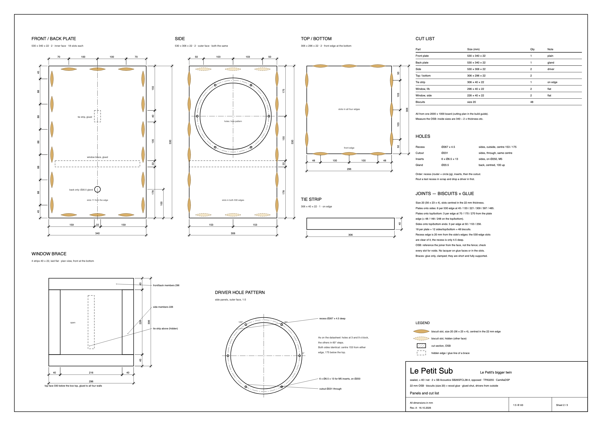
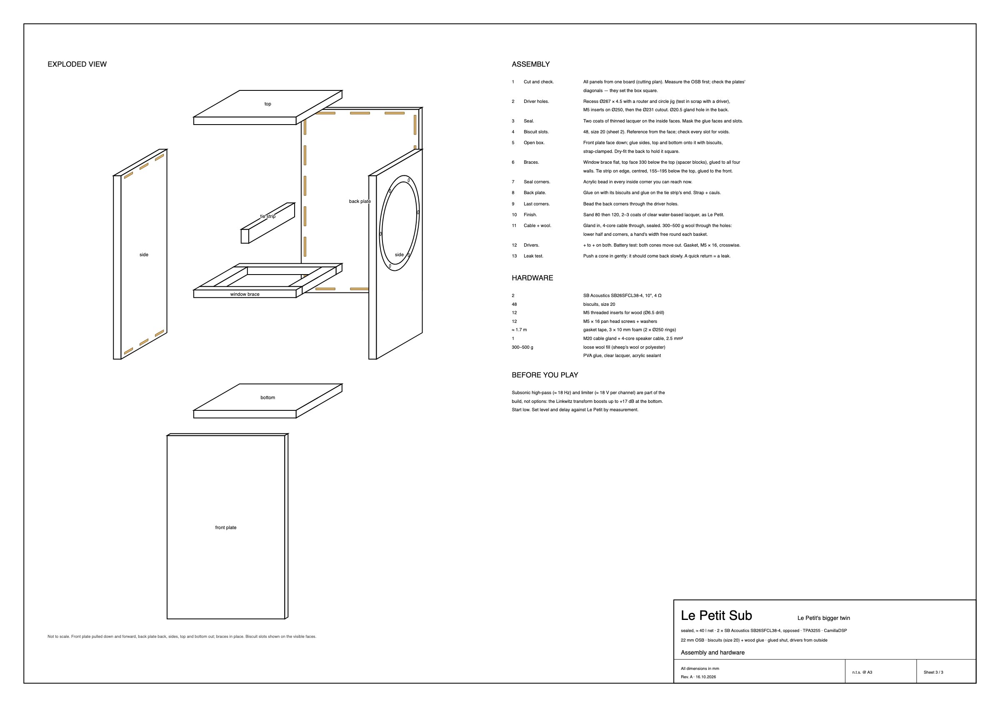

# Building plan

The Le Petit Sub in **22 mm OSB**: front and back are full 340 × 530 plates over everything, the
sides sit between them, top and bottom between the plates and the sides. Butt joints with
**biscuits and wood glue**, glued shut; the drivers go in from outside. All dimensions in mm. The
drawings are vector files (SVG) — open them full size to print at any scale.

> **Rev. A.** The sheets are drawn by
> [make_building_plan.py](https://github.com/rich1704/le-petit-sub-on-a-budget/blob/main/tools/make_building_plan.py)
> from the dimensions in [sub.py](https://github.com/rich1704/le-petit-sub-on-a-budget/blob/main/tools/sub.py),
> which also checks them: inside volume, brace lengths, magnet clearance, recess and insert
> clearances, biscuit spacing and the cutting plan.

## Sheet 1 — Views and sections

Front, left side, section B–B (centre plane: tie strip, window brace, wool, gland), view from behind,
section A–A (at driver height: the opposed drivers and the 38 mm clearance to the tie strip) and
detail C, 2:1 (the driver flush in the side panel).

[Open sheet 1 (SVG)](plans/building-plan-sheet-1.svg)

## Sheet 2 — Panels and cut list

Every panel with its holes and biscuit slots, the two braces, the driver hole pattern, cut list,
hole table and joints.

[Open sheet 2 (SVG)](plans/building-plan-sheet-2.svg)

## Sheet 3 — Assembly and hardware

[Open sheet 3 (SVG)](plans/building-plan-sheet-3.svg)

## Cutting plan

## Dimensions

| | Size |
| --- | --- |
| Outside | 340 × 530 × 350 (W × H × D) — the front is Le Petit's |
| Inside clear | 296 × 486 × 306 = **44.0 l** gross; braces 1.2 l, drivers ≈ 1.5 l each → **≈ 40 l net** |
| Material | 22 mm OSB, butt joints with **biscuits (size 20) and wood glue**, glued shut |
| Drivers | 2 × SB Acoustics SB26SFCL38-4 in the sides, centre 153 from either edge, 175 below the top |

## Cut list

| Part | Size | Qty | Note |
| --- | --- | ---: | --- |
| Front plate | 530 × 340 × 22 | 1 | plain |
| Back plate | 530 × 340 × 22 | 1 | M20 gland |
| Side | 530 × 306 × 22 | 2 | driver recess, cutout, inserts |
| Top / bottom | 306 × 296 × 22 | 2 | |
| Tie strip | 306 × 40 × 22 | 1 | on edge, front to back |
| Window brace, front/back members | 296 × 40 × 22 | 2 | laid flat |
| Window brace, side members | 226 × 40 × 22 | 2 | laid flat |
| Biscuits | size 20 | 48 | |

## Holes

| Hole | Size | Where |
| --- | --- | --- |
| Recess | Ø267 × 4.5 | sides, outside face, centre 153 / 175 |
| Inserts | 6 × Ø6.5 × 13, M5 | sides, on Ø250, at 0° / 60° / … (one at 3 and one at 9 o'clock) |
| Cutout | Ø231 | sides, through, same centre — after recess and inserts |
| Gland | Ø20.5, M20 | back plate, centred, 100 above the bottom edge |

## Driver mounting (detail C)

| | mm | Source |
| --- | --- | --- |
| Frame outside | Ø265 ± 0.5 | datasheet |
| Frame thickness | 3.56 | datasheet |
| Basket behind the frame | Ø228.9 | datasheet |
| Bolt circle | Ø250 ± 0.2, 6 × Ø5.3 | datasheet |
| Depth behind the frame | 116.8 (128.1 overall) | datasheet |
| Recess | Ø267 × 4.5 | frame + 1 mm per side; 3.56 frame on ≈ 1 mm compressed gasket |
| Cutout | Ø231 | basket + 1 mm per side |
| Magnet to tie strip | ≈ 38 | 4.5 + 116.8 from the outside face vs the strip at 159 |
