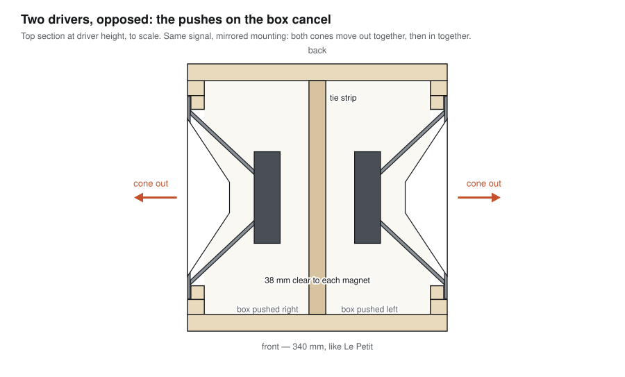
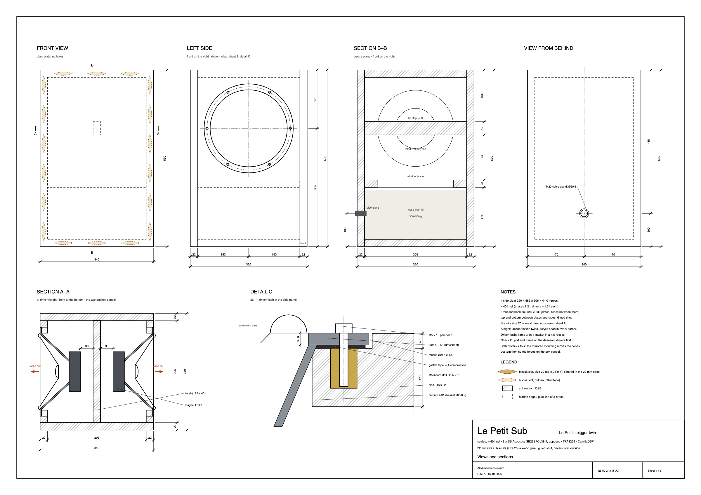
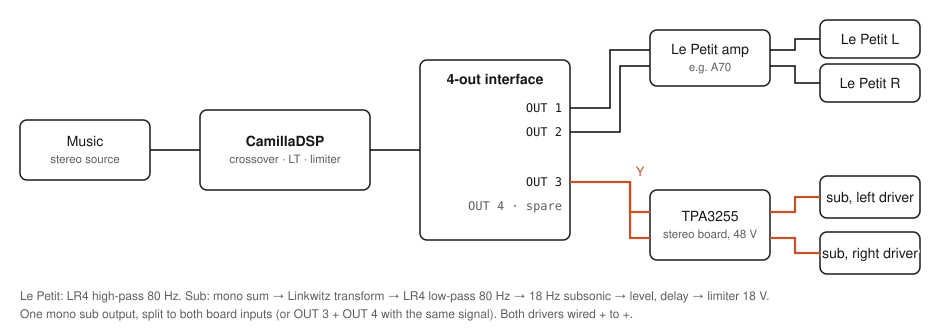
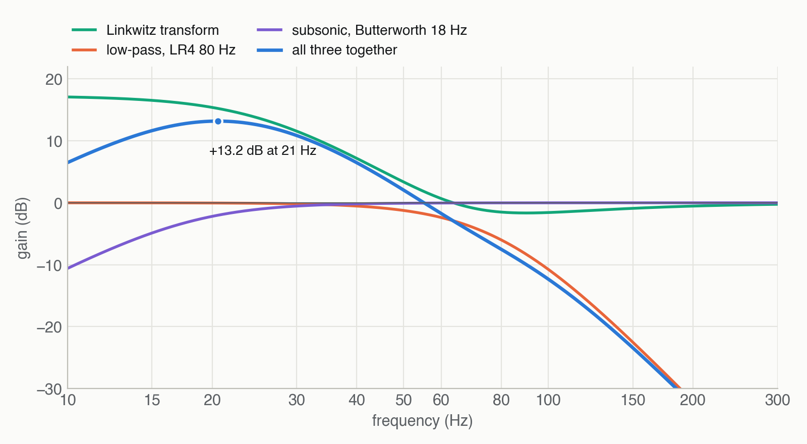
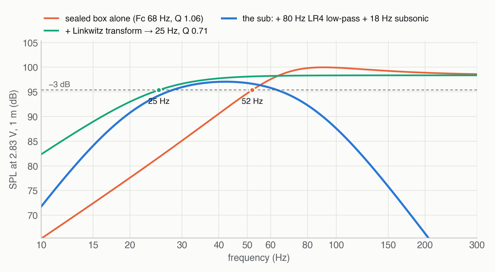
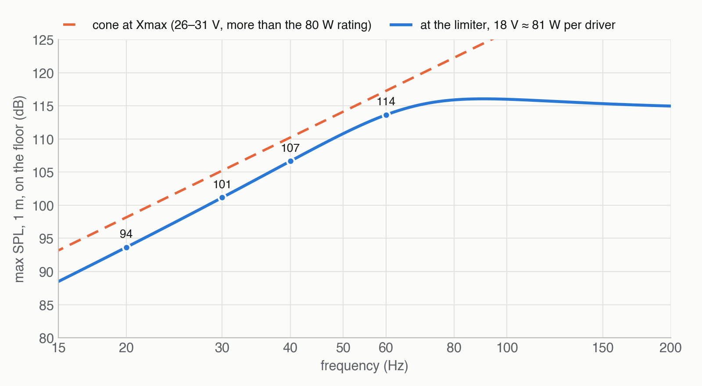

# Le Petit Sub on a budget

**Le Petit's bigger twin: a sealed subwoofer with two opposed 10″ drivers, built from one sheet of
OSB with exactly Le Petit's 340 × 530 front, driven by one TPA3255 board and tuned with CamillaDSP.**

📂 All files, drawings and scripts: **https://github.com/rich1704/le-petit-sub-on-a-budget**

The companion to [Le Petit on a budget](https://github.com/rich1704/le-petit-on-a-budget).

> **In short**
>
> - **One 2000 × 1000 mm board** of 22 mm OSB, two cross cuts, and a 924 × 990 piece stays whole.
> - **2 × SB Acoustics SB26SFCL38-4** (10″, 4 Ω) in the side panels, back to back: the forces on the
>   box cancel, and the front stays a plain face next to the pair.
> - **Sealed, ≈ 40 l net.** The box alone is −3 dB at 52 Hz; a Linkwitz transform in CamillaDSP takes
>   it to **25 Hz**, crossed to Le Petit at **80 Hz**.
> - **≈ €190** with the amp board and the OSB already on hand — the two drivers are most of it.
> - Every drawing, chart and DSP setting is generated by a script from one file of dimensions, and the
>   CamillaDSP config is checked against the real CamillaDSP binary.

## Contents

[Why a sub](#why-a-sub) · [How it works](#how-it-works) · [Build it](#build-it) ·
[Amp and DSP](#amp-and-dsp) · [What to expect](#what-to-expect) · [Cost](#cost) ·
[Options ruled out](#options-ruled-out) · [Repository map](#repository-map) · [Credits](#credits-and-license)

## Why a sub

- **Le Petit stays Le Petit.** Its strength is the midrange and the coherence of one full-range
  driver. None of that changes; the sub only takes over below 80 Hz.
- **The 4″ drivers get cleaner.** Below about 60 Hz a 4″ cone runs out of travel at any real level.
  With an 80 Hz high-pass on Le Petit the small drivers stop fighting for bass they can't make.
- **Real bass, down to 25 Hz** — up to 94 dB at 20 Hz, 101 dB at 30 Hz and 114 dB at 60 Hz at 1 m on
  the floor, before the room adds its own gain. Below 80 Hz you can't hear where bass comes from, so
  one sub between the pair is enough.
- **It looks like part of the set.** Same front size, same OSB, same plain butt-jointed edges. The
  drivers sit in the sides, so from the front it's a quiet block next to the pair.

## How it works



- **Forces cancel.** A moving cone pushes the box the other way. Two mirrored drivers with the same
  signal push in opposite directions, so the box doesn't rock, buzz through the floor or walk at
  high level. Each driver gets its own channel of a stereo TPA3255 board, so the board is evenly loaded.
- **Sealed, no port.** No port noise, no tuning to get right, and the tightest timing in the bass.
  A sealed box rolls off early on its own (−3 dB at 52 Hz here); CamillaDSP lifts the bottom octave
  with a **Linkwitz transform** to a −3 dB point of 25 Hz.
- **The air in the box protects the cones.** Below the box resonance the cone's travel stays almost
  constant: at the limiter it reaches **5.4 mm, 68 % of Xmax**. The subsonic filter at 18 Hz and the
  limiter at 18 V per channel are part of the design, not options.
- **Bracing is still needed:** the forces cancel, the air pressure on the panels doesn't. A tie strip
  links front and back between the magnets; a window brace just below the drivers ties all four walls.

## Build it

| | Specification |
| --- | --- |
| **Box** | 340 × 530 × 350 mm outside (W × H × D), 296 × 486 × 306 inside = **44.0 l gross, ≈ 40 l net** |
| **Material** | one 2000 × 1000 mm board of 22 mm OSB, square edges |
| **Construction** | front and back are full 340 × 530 plates over everything; sides between them, top and bottom between plates and sides — **biscuits (size 20) + wood glue, glued shut** |
| **Drivers** | 2 × SB Acoustics SB26SFCL38-4, 10″, 4 Ω, flush in a Ø267 × 4.5 recess, Ø231 cutout, 6 × M5 inserts each |
| **Bracing** | tie strip 306 × 40 on edge between the magnets; window brace of four 40 × 22 strips, 330 below the top |
| **Damping** | 300–500 g loose wool, lower half and corners |
| **Wiring** | 4-core cable through an M20 gland in the back, one pair per driver, both + to + |

**Everything from one board, two cross cuts:**


**The building plan** — three A3 sheets with every dimension, cut list, holes, biscuit positions and
assembly order: [docs/building-plan.md](building-plan.md).

[](building-plan.md)

**The build guide** in 13 steps — [docs/01-build.md](01-build.md): cut, driver holes, seal,
biscuit slots, the open box, braces, corners, back plate, last corners, finish, cable and wool,
drivers, leak test.

> **Check before you cut.** The driver numbers come from SB Acoustics' datasheet, marked
> *preliminary data*. Rout a test recess in scrap and drop a delivered driver in before you touch
> the side panels, and measure your OSB — if it isn't exactly 22 mm, the inside sizes change with it.

## Amp and DSP



| | Setting |
| --- | --- |
| **Amp** | one stereo TPA3255 board on 48 V, one channel per driver |
| **Signal** | one mono sub output (L + R at −6 dB each), split to both board inputs |
| **Sub** | Linkwitz transform 67.7 Hz / Q 1.06 → 25 Hz / Q 0.71 · LR4 low-pass 80 Hz · Butterworth subsonic 18 Hz · level · delay · limiter at 18 V |
| **Le Petit** | LR4 high-pass 80 Hz |
| **Polarity** | both drivers + to +: the mirrored mounting moves the cones out together |

The ready-to-adapt CamillaDSP v4 config is [docs/dsp/le-petit-sub.yml](dsp/le-petit-sub.yml);
how to set level, delay and limiter is in [docs/02-amp-and-dsp.md](02-amp-and-dsp.md).



## What to expect

Predicted from the driver's Thiele/Small parameters in the box, on the floor (half space), 1 m, no
room gain. The details and the model: [docs/03-design.md](03-design.md).



| | Le Petit | Le Petit Sub |
| --- | --- | --- |
| Outside W × H × D | 340 × 530 × 254 | 340 × 530 × 350 |
| Volume | 27.0 l, vented | 44.0 l gross · ≈ 40 l net, sealed |
| Drivers | 1 × 4″, front | 2 × 10″, sides, opposed |
| −3 dB | 47 Hz (measured) | 25 Hz with the Linkwitz transform (predicted) |
| Max SPL 20 / 30 / 40 / 60 Hz | — | 94 / 101 / 107 / 114 dB (predicted, at the limiter) |



## Cost

Prices from soundimports.eu (NL, ships to Germany) and the DIY store, October 2026. The amp board and
the OSB were already on hand.

| Part | Cost |
| --- | ---: |
| 2 × SB Acoustics SB26SFCL38-4, 10″, 4 Ω, €72.95 each | €146 |
| Shipping, approx. | €10 |
| TPA3255 stereo board on 48 V | already owned |
| 22 mm OSB, one 2000 × 1000 board (≈ 0.9 m² used) | left over |
| 12 × M5 inserts + 12 × M5 × 16 screws | €10 |
| Gasket tape and wool fill | €15 |
| 4-core speaker cable + M20 cable gland | €8 |
| **Total, approx.** | **≈ €190** |

Without an amp on hand, add a TPA3255 stereo board and a 48 V supply.

## Options ruled out

- **One 10″ in a vented box** (the first plan, on a 60 W amp): about 5 dB less everywhere, nothing
  below 25 Hz, and a port that can chuff.
- **One 10″ sealed:** 6 dB less, and a single driver shakes the box.
- **8″ drivers** fit a smaller box but move far less air.
- **Bandpass box or tapped horn:** more output in a narrow band, but bigger and far harder to tune.

## Repository map

```
docs/
├── 01-build.md              build guide, 13 steps, parts list, cutting plan
├── building-plan.md         the building plan: three A3 sheets, cut list, holes, joints
├── 02-amp-and-dsp.md        amp, wiring, crossover, Linkwitz transform, setting level/delay/limiter
├── 03-design.md             driver data, the box model, predictions, cost, options ruled out
├── dsp/le-petit-sub.yml     CamillaDSP v4 example config (generated, checked with CamillaDSP 4.1.3)
├── plans/                   building-plan sheets (SVG + PNG) and the cutting plan
└── assets/                  charts and diagrams
tools/
├── sub.py                   every dimension and driver value, plus the geometry checks
├── make_building_plan.py    the three A3 sheets
├── make_cut_layout.py       the cutting plan
├── make_charts.py           the model, the charts and the CamillaDSP config
├── make_diagrams.py         the web diagrams
├── verify_camilla.py        renders the config through CamillaDSP and compares it with the model
└── svg2png.py               PNG previews of the sheets (headless Chrome)
```

To regenerate everything after changing a dimension in `tools/sub.py`: `make` (needs Python 3 with
numpy, matplotlib and pyyaml, and Chrome for the sheet previews); `make verify CAMILLADSP=/path/to/camilladsp`
checks the DSP config.

## Credits and license

The sub is designed to sit next to **Le Petit**, **Jean Hiraga's** design (*L'Audiophile* no. 29,
1983) — see [Le Petit on a budget](https://github.com/rich1704/le-petit-on-a-budget). Driver data:
SB Acoustics' SB26SFCL38-4 datasheet. Linkwitz transform after **Siegfried Linkwitz**.
Documentation, drawings and charts: **CC BY-SA 4.0**; the scripts in `tools/`: MIT. Details:
[docs/CREDITS.md](CREDITS.md).
